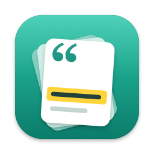
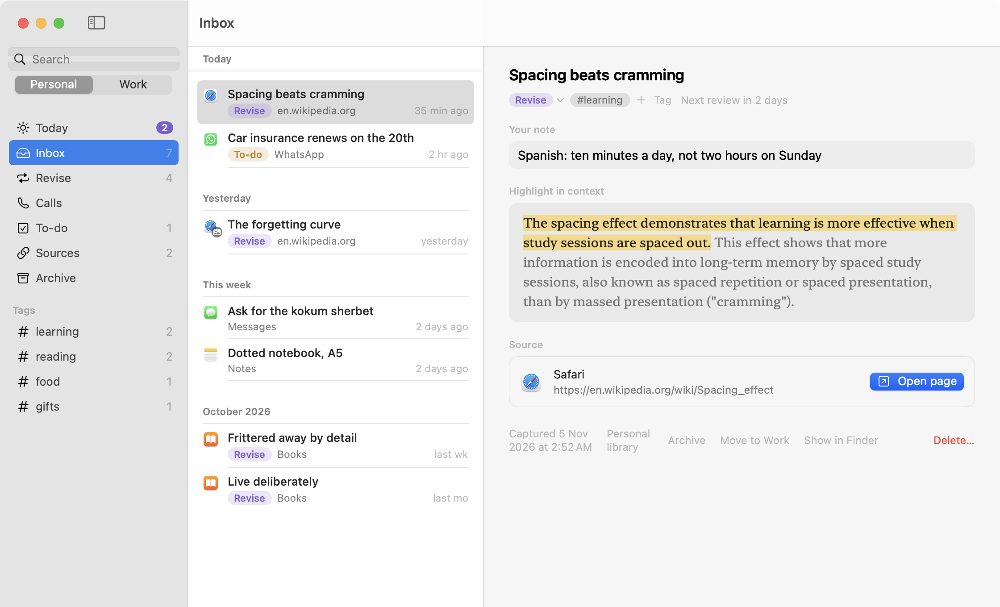
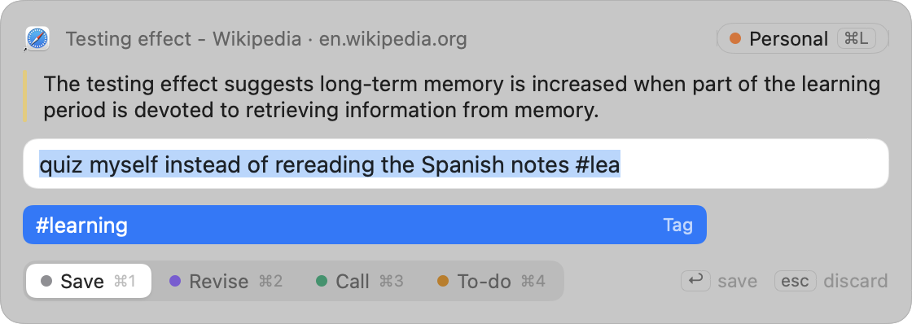
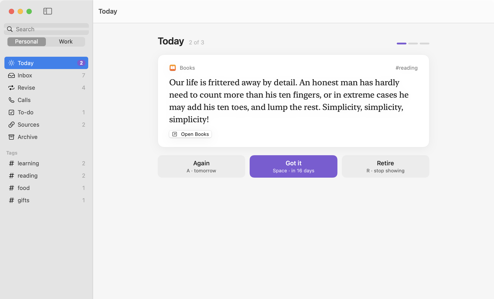
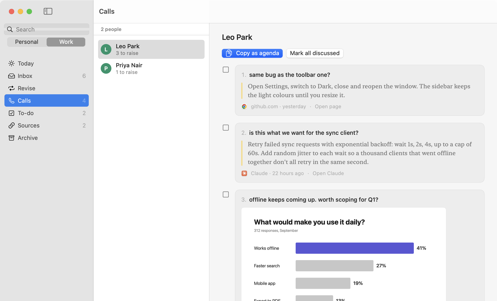

<p align="center">
  
</p>

<h1 align="center">Clipback</h1>

<p align="center">Save text or a screenshot from any Mac app, and see it again later.</p>

Clipback is a menu bar app for saving the bits worth keeping from whatever you read on your Mac. Select some text anywhere (a web page, a Slack thread, a PDF in Preview, a reply in the Claude app) and press <kbd>⌃</kbd><kbd>⌥</kbd><kbd>Space</kbd>. It saves the text as a markdown file along with the page, file or app it came from. With nothing selected, the same keys take a screenshot instead: drag over the part of the screen you want to keep. Clipback reads the text in the screenshot on your Mac, so search can find it later.

Then it brings things back. A quote you want to remember shows up again the next day, then after three days, a week, and so on. Something you want to raise with a colleague waits under their name until your next call. It only keeps what you clip on purpose, so it's not a clipboard manager.

<p align="center">
  
</p>

## Install

Download `Clipback-<version>.dmg` from the [latest release](https://github.com/kb14/clipback/releases/latest), open it and drag Clipback into Applications. It's signed and notarized by Apple, so macOS opens it without a warning. Clipback needs macOS 15 Sequoia or later on an Apple Silicon Mac.

When you open it, a setup window asks for the two permissions it needs (see [Privacy](#privacy)). After that it lives in the menu bar.

Clipback updates itself. On its second launch it asks whether to check for new versions automatically, and **Check for Updates…** in the menu bar checks right away. Your clips and settings stay where they are. **About Clipback** shows your version.

## Usage

1. Select text in any app and press <kbd>⌃</kbd><kbd>⌥</kbd><kbd>Space</kbd>. With nothing selected, drag a box over the part of the screen you want, or press <kbd>Space</kbd> to pick a whole window.
2. A small panel shows what you grabbed. Add a note if you like: `@Maya` files the clip under Maya, `#reading` tags it.
3. Pick what it's for with <kbd>⌘1</kbd> to <kbd>⌘4</kbd> (Save, Revise, Call or To-do) and press <kbd>Return</kbd>. <kbd>Esc</kbd> throws it away.
4. <kbd>⌃</kbd><kbd>⌥</kbd><kbd>N</kbd> opens the library.

<p align="center">
  
</p>

What happens next depends on what you picked:

- Revise clips come up in Today, one card at a time and at most five a day. Press <kbd>Space</kbd> if you remembered it and it comes back after 1, 3, 7, 16, 35 and then 75 days. <kbd>A</kbd> starts it over, <kbd>R</kbd> retires it.
- Call clips are grouped by person. Before a one-on-one, open their name and copy the list as an agenda.
- To-do clips are a checklist.
- Save clips just stay in the library, searchable.

Sources groups everything you clipped from the same article or PDF. Discussed calls, finished to-dos and retired cards move to Archive, where search still finds them.

There are two libraries, Work and Personal. Unless you pick one from the menu bar, Clipback saves into Work on weekdays from 10:00 to 18:00 and into Personal the rest of the time.

<p align="center">
  
  
</p>

## Privacy

Clipback only goes online to check GitHub for a new version, and you can turn that off in Settings. There's no account and no analytics, and nothing is sent to an AI service.

It reads the screen only when you press the hotkey, and keeps only the part you picked. For text clips it also keeps one screenshot of the window the text came from, so you can see it in context later. Clips are plain markdown files in `~/Clipback` (or a folder you choose), and they stay there if you delete the app.

Clipback's own windows don't appear when you share your screen in Zoom, Meet or Slack. It won't capture while a password field is focused, or while 1Password, Bitwarden or Apple's Passwords app is in front.

macOS will ask for three permissions:

| Permission | What it's used for |
|---|---|
| Accessibility | Reading the text you selected and the title of its window |
| Screen Recording | Taking the screenshot when you press the hotkey. macOS asks again about once a month. |
| Automation, per browser | Reading the address of the current tab, so the clip links back to it |

Clipback's setup window asks for the first two when you first open it. Screen Recording only takes effect after macOS quits and reopens the app; when it does, the setup window comes back to say Clipback is ready. On some Macs, Sequoia never shows the Screen Recording prompt. If that happens, the setup window walks you through adding Clipback by hand in System Settings.

## Similar apps

- [Readwise](https://readwise.io) has the best daily review around and pulls highlights from Kindle, Apple Books, articles, PDFs, X and podcasts. It's a paid cloud service and can't take text from just any Mac app. If most of what you read is ebooks and articles, use Readwise.
- [DoubleMemory](https://doublememory.com) saves text, links and images from any app when you press <kbd>⌘C</kbd> twice, and reads the text in saved images. It's more of a bookmark library: it can shuffle old items back to you, but there's no review schedule, and nothing for people or to-dos.
- Apple's Quick Note keeps links and highlights from Safari. Other apps are hit and miss.
- [CleanShot X](https://cleanshot.com) and [TextSniper](https://textsniper.app) are better at screenshots and OCR. They don't keep a library you come back to.
- [PopClip](https://www.popclip.app) extensions can send selected text to Obsidian, Notes or Readwise. If you already have a notes system you like, that may be all you need.
- [Screenpipe](https://screenpipe.com) records your screen all day so you can search it later. Clipback only keeps what you pick.
- [Obsidian Web Clipper](https://obsidian.md/clipper) saves pages and highlights into Obsidian, from the browser only.

## Your files

Each clip is one markdown file, with its screenshot (if any) next to it:

```markdown
---
id: 01JC4Z8Q2M7V3T9K5W1N6R0BXA
created: 2026-11-05T09:14:22+05:30
library: personal
intent: revise
tags: ["learning"]
title: "Spacing beats cramming"
source:
  app: "Safari"
  url: "https://en.wikipedia.org/wiki/Spacing_effect"
review:
  next: 2026-11-07
  step: 1
  status: active
---

> The spacing effect demonstrates that learning is more effective when study sessions are spaced out.

**Note:** Spanish: ten minutes a day, not two hours on Sunday
```

You can open the folder as an Obsidian vault, grep it, or back it up like any other folder. Edits you make outside Clipback show up in the app straight away.

## Known limits

- Firefox doesn't let other apps read the current tab's address, so Firefox clips have no link. Safari, Chrome, Arc, Brave, Edge and Dia work.
- Terminal.app doesn't report selected text. Drag over it as a screenshot instead.
- There's no sync between Macs, no iPhone app and no Kindle import.

## Why I made it

I read in a lot of places in a day: articles, Slack, PDFs, meeting notes, long answers from Claude. The good bits ended up as bookmarks and screenshots I never opened again. When I did find one, I'd forgotten where it came from.

So I wanted one key that works in every app and remembers the source. And I wanted the clip to come back when it's useful: a few days later if I'm trying to remember it, or in my next call with the person it's about.

## Build from source

You need Xcode 16 or later.

```bash
git clone https://github.com/kb14/clipback.git
cd clipback
swift test                 # core tests
./scripts/install.sh       # builds a Release copy into /Applications
```

`scripts/build.sh` signs with your "Developer ID Application" certificate if you have one, or else your first "Apple Development" certificate, so macOS keeps its permissions across rebuilds. Set `CLIPBACK_SIGN_ID` to pick another. With no certificate it signs ad hoc, and you'll need to allow the permissions again after each build.

## Contributing

Issues and pull requests are welcome. See [CONTRIBUTING.md](CONTRIBUTING.md) for building, testing and checking UI changes.

Built with [Claude Code](https://claude.com/claude-code).

## License

[MIT](LICENSE)
